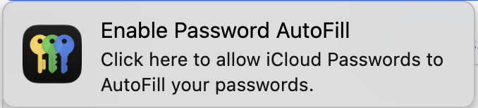

# Better Passwords (extension for Apple Passwords)

[](https://github.com/fanckush/better-passwords-extension/actions/workflows/ci.yml)
[](https://github.com/fanckush/better-passwords-extension/actions/workflows/ci.yml)
[](https://github.com/fanckush/better-passwords-extension/releases/latest)
[](LICENSE)
[](#setup)

**An alternative to Apple's iCloud Passwords extension for Chromium and firefox based browsers**

## Why

I am honestly sick of seeing this all the time

<picture>
  <source media="(prefers-color-scheme: dark)" srcset="docs/images/apple-autofill-prompt-dark.png">
  
</picture>

also, Apple's extension **doesn't** suggest passwords when signing up!

## Demo

Visit [betterpasswords.app](https://betterpasswords.app) for an interactive dummy form

[Chrome Web Store][chrome-web-store] · [Firefox Add-ons][firefox-addons] · [Website](https://betterpasswords.app) · [Setup](#setup)

<picture>
  <source media="(prefers-color-scheme: dark)" srcset="docs/images/screenshot-dark.png">
  
</picture>

## Features

- ✏️ login suggestions
- 🔐 password generatino on sign-ups
- ✨ NO MORE 6 DIGIT CODES!! *
- 💾 asks to save/update new logins you type (obviously)
- ☁️ generate Hide My Email on sign-ups (needs iCloud+)
- 👤 suggest yoru email addresses from your contact card *

\* Needs [companion Mac app](docs/companion.md)

## Installotion

- **Chrome, Arc, Brave, Edge, Vivaldi and other Chromium browsers:** [Chrome Web Store][chrome-web-store]
- **Firefox and Zen:** [Firefox Add-ons][firefox-addons]

Or manually download `better-passwords-<version>-chrome.zip` from the [latest release](https://github.com/fanckush/better-passwords-extension/releases/latest), unzip it, open `chrome://extensions`, turn on **Developer mode** and choose **Load unpacked**. Manual installs don't support auto updates (similar steps for FF)

### Connect to apple passwords

[Download the optional companion Mac app](https://betterpasswords.app/companion) ([how it works](docs/companion.md)), move it to Applications, open **Better Passwords.app**, and choose **Connect**. It also enables Touch ID and contact email suggestions after you allow the required permissions.

Or run the setup script without the companion app:

```sh
curl -fsSL https://github.com/fanckush/better-passwords-extension/raw/main/scripts/setup-mac.sh | sh
```

The script lets the extension reach Apple's built-in password helper. You can find it [here](scripts/setup-mac.sh). To undo use it with `--uninstall`.

The setup connects Chrome, Brave, Edge, Vivaldi, Arc, Helium, Crest, Chromium, Firefox and Zen. Using another browser? [Ask for it](https://github.com/fanckush/better-passwords-extension/issues/new?template=browser.yml).

## Contributing

Contributions are welcome. [CONTRIBUTING.md](CONTRIBUTING.md) covers setup (Bun), tests, and how to try changes against the real helper. Please report security issues privately, as described in [SECURITY.md](SECURITY.md).

## Credits

Thanks to the authors of the following projects for inspiring me to build this:

- [Open Passwords](https://github.com/ManiForoughi2/open-passwords) fills from Apple Passwords in Chrome and Edge. It showed that keeping the connection to Apple's helper open means far fewer six-digit codes.
- [iCloud Hide My Email](https://github.com/dedoussis/icloud-hide-my-email-browser-extension) by Dimitrios Dedoussis showed how to use Hide My Email from a browser.

## License

[MIT](LICENSE). The protocol knowledge builds on earlier Apache-2.0 projects, credited in [NOTICE](NOTICE).

<!-- Store listings: apps/site/assets/browser.js links the same pages. -->

[chrome-web-store]: https://chromewebstore.google.com/detail/better-passwords/ocongmkplhijgajnipnhhggfcjfdilgj
[firefox-addons]: https://addons.mozilla.org/firefox/addon/better-passwords/

> Not affiliated with or endorsed by Apple Inc. "Apple" and "iCloud" are trademarks of Apple Inc.
