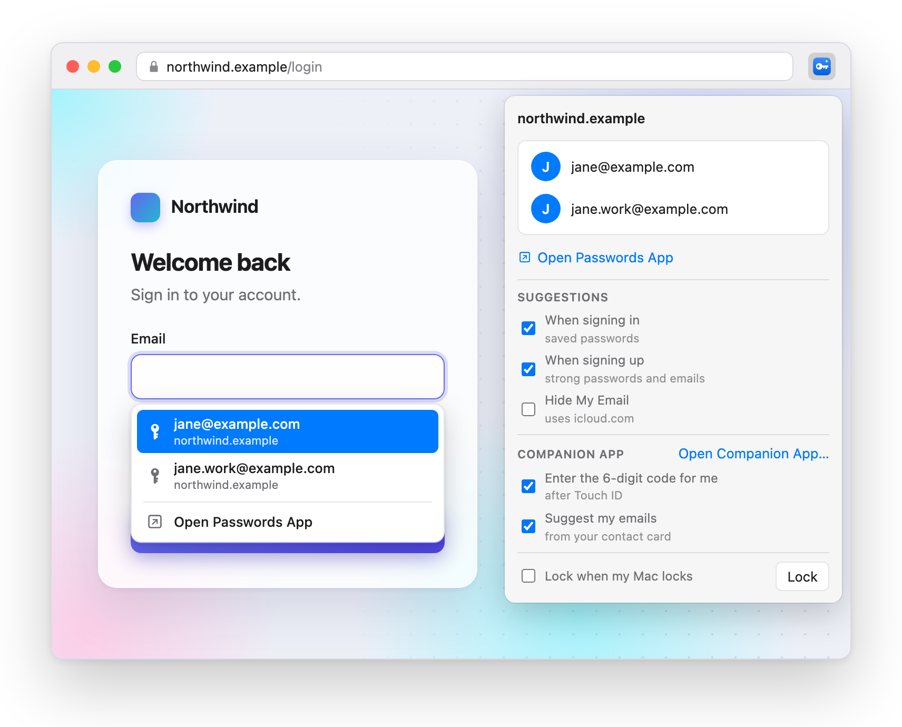

# Better Passwords (extension for Apple Passwords)

[](https://github.com/fanckush/better-passwords-extension/actions/workflows/ci.yml)
[](https://github.com/fanckush/better-passwords-extension/actions/workflows/ci.yml)
[](https://github.com/fanckush/better-passwords-extension/releases/latest)
[](LICENSE)
[](#setup)

**An alternative to Apple's iCloud Passwords extension for Chromium and firefox based browsers**

Fill logins from Apple Passwords (iCloud Keychain) in any browser on your Mac. Pair once per browser launch instead of typing a six-digit code every few hours, or unlock with Touch ID. Free and open source.

[Chrome Web Store][chrome-web-store] · [Firefox Add-ons][firefox-addons] · [Website](https://betterpasswords.app) · [Setup](#setup)

<picture>
  <source media="(prefers-color-scheme: dark)" srcset="docs/images/screenshot-dark.png">
  
</picture>

> Not affiliated with or endorsed by Apple Inc. "Apple" and "iCloud" are trademarks of Apple Inc.

## Features

- Login suggestions right in the field, or fill from the toolbar button
- Strong passwords on sign-up forms, saved to Apple Passwords
- Hide My Email on sign-up forms (opt-in, needs iCloud+)
- Unlock with Touch ID, and suggest the emails on your contact card, with the optional [companion app](docs/companion.md)
- Lock any time, or automatically when your Mac locks
- Open the Passwords app for the current site
- Works in Chrome, Arc, Brave, Edge, Vivaldi, Chromium, Helium and Firefox

## Compared with Apple's iCloud Passwords extension

| | iCloud Passwords | Better Passwords |
|---|---|---|
| Made by | Apple | An indie developer, [@fanckush](https://github.com/fanckush) |
| Fills your Apple Passwords | Yes | Yes |
| Strong passwords for sign-ups | Opens the Passwords app | Suggested right in the field |
| Hide My Email in sign-up forms | Not available | Yes, with iCloud+ |
| Your own emails in sign-up forms | Not available | From your contact card\* |
| Unlocks with | Six digits from your Mac | Six digits, or Touch ID\* |
| How often | Each time the browser puts it to sleep | Once, until you quit the browser |
| Windows | Yes, with iCloud for Windows | Mac only for now |
| Price | Free | Free and open source |

\* Needs the free [companion Mac app](docs/companion.md).

## Why

Apple's iCloud Passwords extension loses its connection whenever the browser idles its background worker, and every reconnect means typing a new code from your Mac. This extension keeps the connection open, so you pair **once per browser launch**.

It talks to the same Apple helper that ships with macOS, through the same encrypted pairing, so your passwords never leave Apple's own software except to fill the page you choose.

## Setup

Requirements: macOS 14 (Sonoma) or later, signed in to iCloud with Passwords turned on.

### 1. Install the extension

- **Chrome, Arc, Brave, Edge, Vivaldi and other Chromium browsers:** [Chrome Web Store][chrome-web-store]
- **Firefox:** [Firefox Add-ons][firefox-addons]

Rather install by hand? Download `better-passwords-<version>-chrome.zip` from the [latest release](https://github.com/fanckush/better-passwords-extension/releases/latest), unzip it, open `chrome://extensions`, turn on **Developer mode** and choose **Load unpacked**. Manual installs don't update themselves.

Apple's iCloud Passwords extension can stay installed, though two autofill menus on the same field can get in each other's way.

### 2. Connect your browser once

Install the optional [companion Mac app](docs/companion.md), open **Better Passwords.app**, and choose **Connect**. It also enables Touch ID and contact email suggestions after you allow the required permissions.

Or run the setup script without the companion app:

```sh
curl -fsSL https://github.com/fanckush/better-passwords-extension/raw/main/scripts/setup-mac.sh | sh
```

The script lets the extension reach Apple's built-in password helper. It writes one small file per browser and needs no admin rights. [Read it](scripts/setup-mac.sh) first, and undo it any time with `--uninstall`.

### 3. Unlock

Click the toolbar icon and enter the code your Mac shows, or unlock with Touch ID through the companion. Hide My Email is optional, requires iCloud+, and uses your icloud.com sign-in in this browser.

## How it works

See [docs/architecture.md](docs/architecture.md), [docs/protocol.md](docs/protocol.md) and [docs/threat-model.md](docs/threat-model.md). There is no project backend or tracking. Opt-in Hide My Email connects to Apple’s iCloud: see the [privacy policy](PRIVACY.md).

## Contributing

Contributions are welcome. [CONTRIBUTING.md](CONTRIBUTING.md) covers setup (Bun), tests, and how to try changes against the real helper. Please report security issues privately, as described in [SECURITY.md](SECURITY.md).

## Credits

Better Passwords stands on the shoulders of two open source extensions:

- [Open Passwords](https://github.com/ManiForoughi2/open-passwords), an extension for Apple Passwords in Chrome and Edge that showed the code prompts could be tamed.
- [iCloud Hide My Email](https://github.com/dedoussis/icloud-hide-my-email-browser-extension) by Dimitrios Dedoussis, which worked out how to use Hide My Email from a browser.

Thank you to their authors. [NOTICE](NOTICE) lists every project this one builds on.

## License

[MIT](LICENSE). The protocol knowledge builds on earlier Apache-2.0 projects, credited in [NOTICE](NOTICE).

<!-- Store listings: apps/site/assets/browser.js links the same pages. -->
[chrome-web-store]: https://chromewebstore.google.com/detail/better-passwords/ocongmkplhijgajnipnhhggfcjfdilgj
[firefox-addons]: https://addons.mozilla.org/firefox/addon/better-passwords/
